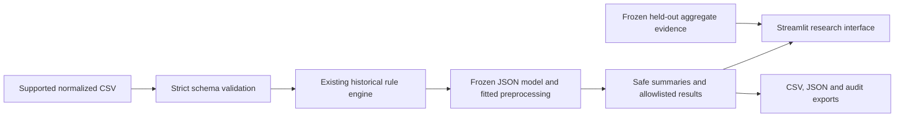

# Local research prototype architecture

The scientific source remains in `analysis/`. The new application uses thin
adapters, not a second set of eligibility rules.

The scientific baseline and local parity fixtures stay in `.local/`. The model
build is an explicit offline command. Uploading data never fits a model. The
runtime loads a data-only JSON artifact rather than an executable model pickle.

Uploads are processed in the Streamlit session in memory; the application does
not write uploads to disk. Export identifiers are generated row labels and do
not encode submitted IDs. An explicit display/export allowlist omits household
identifiers, person numbers, spouse pointers, raw income and original record IDs.
The app is intended for controlled local research use, not public applicant
processing. Synthetic examples are the only committed app fixtures.

Historical screening, observed receipt, and model probability are independent
fields. A high model score never changes a screen or receipt response. App
scores from the full-data fitted model are not held-out research performance.
The performance page reads aggregate evidence from the frozen evaluation run.
