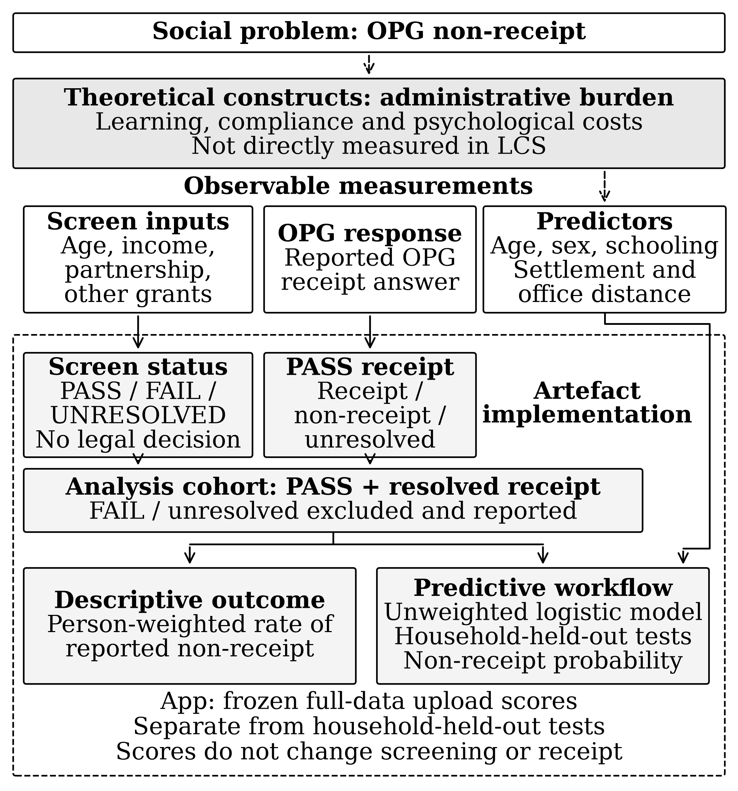

# Conceptual framework — current working section

The subsection below mirrors Section II.D of the current manuscript. Edit
`manuscript.md` for the build; this file records the framework and supporting
predictor mapping. The build does not import this working copy automatically.

### D. Conceptual Framework

Reported OPG non-receipt among apparently eligible older adults motivates an administrative-burden perspective [12], [16]. Learning, compliance and psychological costs may obstruct access; high receipt does not establish low burden.

Figure 1 separates theoretical constructs from LCS measurements. Schooling may reflect information resources; office distance and settlement relate to potential compliance effort. Age and sex provide demographic context. These proxies do not directly measure burden. Screening defines the denominator because age alone is insufficient and LCS cannot establish legal entitlement. Resource, partnership and other-grant rules define the population; incomplete information remains unresolved. Reported receipt defines a separate outcome.

Person-weighted estimates describe non-receipt. Logistic regression describes associations; household-held-out validation tests predictions. Neither establishes causal mechanisms. The artefact implements the design through shared rules, separate receipt classifications, saved-model scoring and inspectable reports. Upload scores remain separate from held-out evaluation and never change screening or receipt.

## Diagram and interpretation

The refined Figure 1 separates five layers: theoretical constructs, observable
measurements, screening decisions, descriptive outcome and predictive workflow.
Dashed arrows express the rationale for predictor selection. Solid arrows show
analytical dependencies; neither kind establishes a causal effect. The dashed
enclosure identifies the artefact's implementation scope. It does not represent
another causal factor.

Learning, compliance and psychological costs are not directly measured in LCS.
The screening rules define the analytical population, and the receipt response
defines the separate reported outcome. Only PASS records with resolved receipt
enter the descriptive and predictive analyses. Person weights describe
non-receipt; the primary logistic model is unweighted. Household-held-out tests
assess internal prediction. Frozen full-data upload scores remain separate from
those tests and never alter screen or receipt categories.

Section VI.E returns to the framework. Sex differences support demographic
comparison; they do not confirm a burden mechanism. The schooling association
runs contrary to a simple information-barrier expectation. Distance and
settlement intervals leave compliance-cost expectations unresolved, while
psychological costs remain untested. Proxy associations cannot directly test
administrative-burden theory. The artefact makes these bounded measurement
choices reproducible and inspectable.

## Supporting predictor mapping

The following rows mirror the revised Table II.

| Predictor | Theoretical role | LCS coding and limit |
| --- | --- | --- |
| Age | Demographic context: receipt differs by age [2] | Per decade above 60; health and application history unmeasured. |
| Sex | Demographic context: receipt differs by sex [2], [6] | Female versus male; social roles and discrimination unmeasured. |
| Schooling | Learning costs: schooling may help people find and understand grant information [12], [15] | Below Grade 7 versus Grade 7 or above; awareness and literacy unmeasured. |
| Settlement | Compliance costs: place may shape service access [9], [16], [17] | Urban informal and traditional/rural formal, each versus urban formal; office capacity unmeasured. |
| Office distance | Compliance costs: distance may add travel effort [15], [16] | At least 5 km/unavailable versus nearer than 5 km; visits and travel costs unmeasured. |

Psychological costs are unmeasured. Settlement contributes two contrasts, giving five predictor groups and six slopes.

## Citation provenance for manuscript integration

The bracketed identifiers above are stable source identifiers in `paper/references.json`, retained from the earlier manuscript. The compact manuscript build generates first-appearance IEEE numbers; `paper/citation_map.json` maps between the two. No new source is introduced. The original Submission 1 contains the following complete theory-source records; their previously abbreviated titles are now restored:

- [12] D. P. Moynihan, P. Herd, and H. Harvey, “Administrative burden: Learning, psychological, and compliance costs in citizen-state interactions,” *Journal of Public Administration Research and Theory*, vol. 25, no. 1, pp. 43–69, 2015, doi: 10.1093/jopart/muu009.
- [13] C. J. Heinrich and R. Brill, “Stopped in the name of the law: Administrative burden and its implications for cash transfer program effectiveness,” *World Development*, vol. 72, pp. 277–295, 2015, doi: 10.1016/j.worlddev.2015.03.015.

These details are verified against the already-submitted PDF, not independently against the journal publishers. Final bibliographic verification should check the complete existing list and retain the distinction between direct OPG evidence and evidence about other grants.
