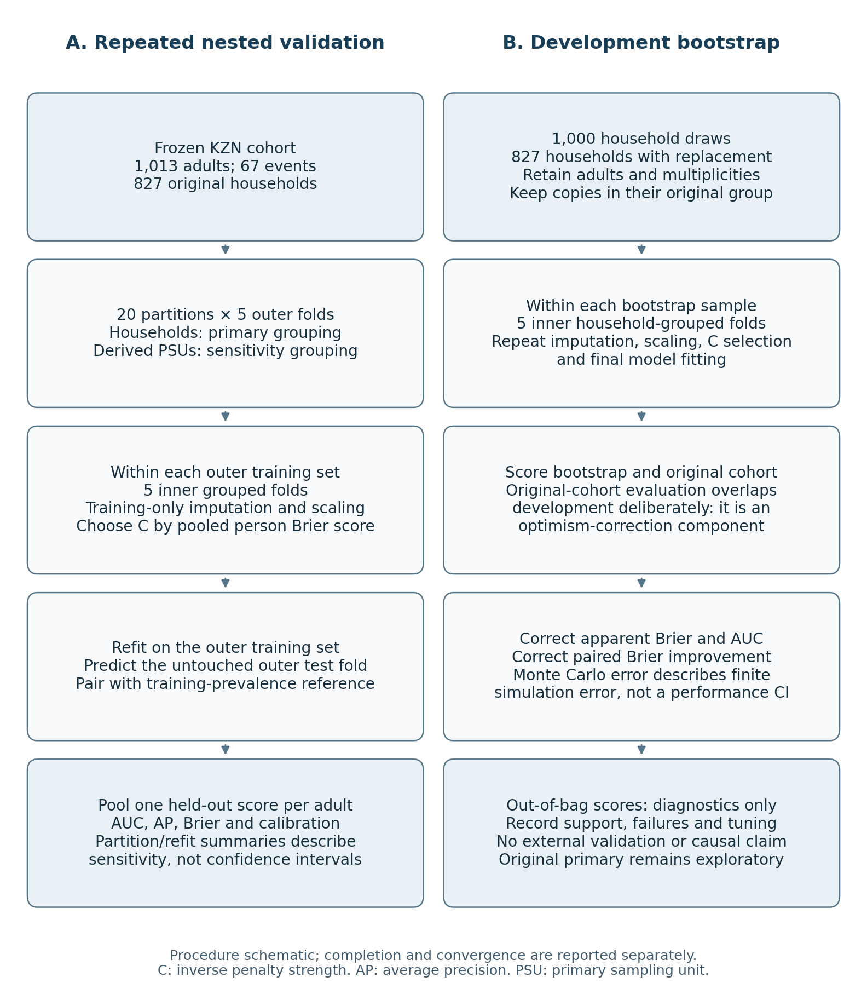
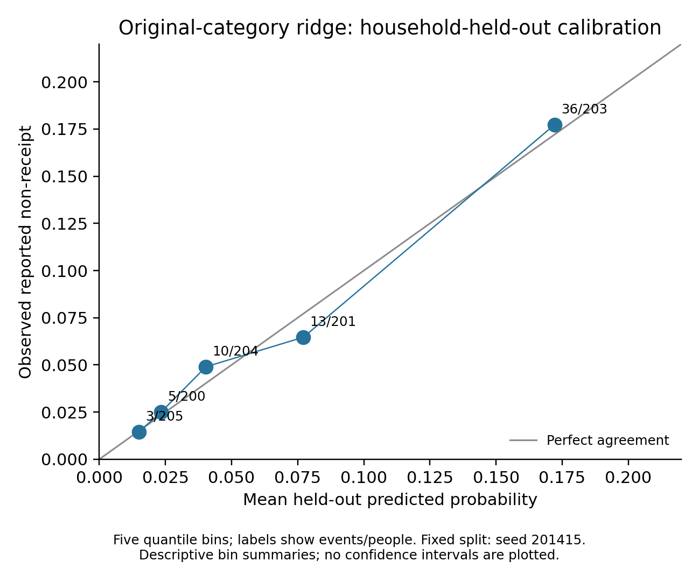

# Publication methodology and validation extension

**Technical report for author review — 28 October 2026**

This report follows the supervisor's methodological comments. It documents additional analyses of the existing KwaZulu-Natal study and supplies wording for author review. It is not an anonymised IST-Africa submission. The submitted Honours paper, its original results and the application's frozen model remain preserved at commit `e5fd403`.

## 1. What changed and what stayed fixed

The extension uses the same 1,013 screened adults, 67 reported non-receipt events, 827 households and 345 derived primary sampling units (PSUs). It does not change screening, receipt, raw predictor fields or the descriptive denominator. The original ordinary six-slope model remains exploratory because the D-052 settlement merger followed inspection of the outcomes.

The additional candidate keeps all four original settlement categories and uses ridge logistic regression. Ridge shrinks coefficients to help fit sparse categories without merging them after inspecting their events. The five predictor groups therefore produce seven slopes. This removes the candidate algorithm's operational reliance on D-052; it does not erase prior outcome exposure or make the study confirmatory.

| Supervisor concern | Treatment in this extension | Status |
| --- | --- | --- |
| Historical thresholds and rules | Retained the source-linked research screen, four income boundaries and documented partnership assumptions. | Preserved |
| Outcome-informed settlement merger | Added a fixed original-category ridge candidate with nested validation; retained the original model's exploratory designation. | Extended |
| Weighted and unweighted descriptions | Kept Table V's separate columns and the existing person-weighted descriptive analysis. | Preserved |
| Small-event interpretation | Reported penalised coefficient stability without importing the old model's Wald intervals or causal claims. | Extended |
| Ethics requirements | Retained the author-confirmed institutional guidance from the supervisors and existing data-use conditions. | Preserved |
| References and contribution | Kept the author-verified references and the bounded reproducible-workflow contribution. No new bibliographic verification is claimed. | Preserved |

## 2. Validation of the specified development procedure

The candidate uses age per decade above 60, sex, schooling, settlement and office distance. Urban formal remains the settlement reference; urban informal, traditional and rural formal each receive their own contrast. Income, receipt, screening labels, identifiers and weights never enter the predictor matrix.

Each repetition used five outer grouped folds. Within each outer training set, five inner grouped folds selected inverse penalty strength C from 0.01, 0.1, 0.3, 1, 3, 10, 30 and 100. Selection minimised pooled inner held-out person-level Brier error. This weights each validation person equally; the earlier ridge comparison instead averaged fold-level Brier scores. Exact ties selected the smaller C.

Training rows alone supplied median/mode imputation and standardisation. Each inner fold learned its own settings; the complete outer training set supplied new settings for the selected model's final fit. The intercept was unpenalised. All modelled adults from an original household stayed together, including when the wider grouping unit was PSU.

Twenty fixed seeds, 201415–201434, provided household-grouped repetitions. Another twenty used derived-PSU grouping at both validation levels. Each adult received exactly one outer-held-out prediction per repetition. The reference predicted the outer training set's event prevalence on the identical test adults. The primary added-value measure was paired Brier improvement: reference error minus candidate error. Positive values favour the candidate.

## 3. Held-out findings

Seed 201415 was the fixed reference partition, rather than the best-performing partition. All 40 repetitions had complete held-out coverage and valid calibration estimates.

| Measure | Household grouping | Derived-PSU grouping |
| --- | --- | --- |
| AUC | 0.7499 | 0.7530 |
| Average precision | 0.2049 | 0.1971 |
| Candidate Brier | 0.05769 | 0.05756 |
| Reference Brier | 0.06177 | 0.06179 |
| Paired Brier improvement | 0.00408 | 0.00423 |
| Log loss | 0.21741 | 0.21703 |
| Calibration-in-the-large | 0.00957 | 0.00174 |
| Calibration slope | 0.9783 | 0.9471 |

Across the twenty household repetitions, median AUC was 0.7505, with interquartile range 0.7447–0.7537 and range 0.7268–0.7682. Median Brier was 0.05767, with interquartile range 0.05726–0.05788 and range 0.05664–0.05873. Median calibration slope was 0.9662; its range was 0.7979–1.0869.

The corresponding PSU medians were AUC 0.7459 and Brier 0.05777. Their interquartile ranges were 0.7427–0.7549 and 0.05736–0.05802; their full ranges were 0.7334–0.7692 and 0.05680–0.05861. Median PSU calibration slope was 0.9446, with range 0.8314–1.0756. Missing survey strata still prevent full survey-design validation.

Paired Brier improvement was positive in every repetition. It ranged from 0.00304 to 0.00513 for household grouping and from 0.00329 to 0.00501 for PSU grouping. These findings describe stability across partitions of the same participants. The repetitions are not independent studies; their ranges and interquartile ranges are not confidence intervals or significance tests.

For context, the archived ordinary merged model had reference-partition AUC 0.7522 and Brier 0.05778. The candidate's corresponding values were 0.7499 and 0.05769. These small descriptive differences do not establish superiority. The methodological improvement is a convergent original-category procedure with nested tuning and inspectable validation, rather than evidence of substantially better prediction.

## 4. Full-development household bootstrap

All 1,000 specified bootstrap draws completed, with no invalid draws or replacement draws. Each sampled 827 households with replacement and retained their adults and multiplicities. Repeated copies retained their original household identifier inside inner validation, preventing copies of the same household from crossing training and validation boundaries.

Each draw repeated imputation, scaling, penalty selection and final fitting. The fitted bootstrap model was evaluated on its bootstrap sample and on the original cohort. The latter deliberately overlaps development data: it contributes to optimism correction and is not held-out evaluation. For Brier and AUC, the corrected estimate equals original apparent performance plus the mean difference between original-cohort and bootstrap-sample evaluations. The reference and paired Brier improvement used the same draws.

| Measure | Apparent | Mean correction | Corrected | MCSE |
| --- | --- | --- | --- | --- |
| Candidate Brier | 0.056104 | +0.001724 | 0.057828 | 0.000204 |
| Reference Brier | 0.061766 | +0.000477 | 0.062242 | 0.000235 |
| Paired Brier improvement | 0.005662 | −0.001248 | 0.004414 | 0.000062 |
| AUC | 0.784403 | −0.017732 | 0.766671 | 0.000959 |

MCSE is the Monte Carlo standard error of the mean correction. It describes finite simulation error, not sampling uncertainty or a confidence interval for predictive performance. The paired improvement and its MCSE were calculated from paired differences, rather than by subtracting independent uncertainty estimates. Average precision and calibration estimates were not mechanically optimism-corrected.

Nested validation evaluates a development procedure trained on approximately 80% of the cohort. Bootstrap-corrected apparent estimates concern full-cohort development. These targets differ, so their numbers should remain separate. The corrected AUC of 0.7667 is not a replacement for, or an improvement over, the household-held-out AUC of 0.7499.

Bootstrap samples contained a median of 523 unique households, ranging from 491 to 552. Event counts ranged from 39 to 96. Out-of-bag samples had a median of 373 adults and 25 events; the respective ranges were 331–416 and 13–39. Their metrics are retained as diagnostics. Variable support and prevalence prevent treating their quantiles as confidence intervals for nested-validation performance.

All 1,000 draws supplied valid Brier and AUC corrections. Calibration-slope fitting was flagged as unsuccessful in seven draws for each of the bootstrap, original-cohort and out-of-bag evaluations. Those slopes remain unavailable: the valid denominator is 993 for each evaluation. This does not invalidate the other metrics or justify replacing the draws.

## 5. Convergence, tuning and coefficient caution

All 48,040 inner fits and 1,201 selected final fits converged: 49,241 fits in total. The final-fit count comprises 200 outer fits, 1,000 bootstrap fits and one full-data candidate. Twenty-two synthetic safeguards also passed, covering training-only learning, grouped copies, complete prediction coverage, paired calculations, invalid-draw accounting and correction signs. These checks support implementation; they do not establish external predictive validity.

The full-data candidate selected C = 0.1. Of the 200 outer fits, 162 selected 0.1. The bootstrap distribution was:

| C | Bootstrap selections | Percentage |
| --- | --- | --- |
| 0.01 | 162 | 16.2% |
| 0.1 | 706 | 70.6% |
| 0.3 | 84 | 8.4% |
| 1 | 12 | 1.2% |
| 3 | 11 | 1.1% |
| 10 | 2 | 0.2% |
| 30 | 0 | 0.0% |
| 100 | 23 | 2.3% |

Boundary values occurred in 185/1,000 bootstrap fits (18.5%) and 6/200 outer fits (3.0%). This is a tuning limitation to disclose. The grid was not extended after examining these results; the analysis does not claim an exhaustive penalty search.

Coefficients were transformed back to the original encoded units before comparing them. Female and below-Grade-7 coefficients were negative in all 1,000 draws. Rural formal settlement was negative in 713 and positive in 287 draws; urban informal settlement was negative in 356 and positive in 644. Sign stability reuses the same underlying adults and does not independently confirm an association. Only 67 original events support the analysis. Penalised stability distributions are not the old ordinary model's Wald intervals, and they do not establish that schooling, sex or settlement causes grant access or measures administrative burden directly.

## 6. Proposed methods and results additions for author review

### Section III.D: additional validation

As a retrospective sensitivity analysis, we retained the original four settlement categories and fitted ridge logistic regression with seven slopes. Five inner household-grouped folds selected C by pooled person-level Brier score inside each of five outer household folds. Each relevant training set independently supplied imputation and scaling. Twenty fixed outer partitions assessed partition and refitting sensitivity; derived-PSU grouping repeated the procedure. A training-prevalence reference supplied paired Brier comparisons on the same held-out adults. A separate 1,000-draw household bootstrap repeated the full development procedure and estimated optimism corrections for apparent Brier and AUC, retaining household multiplicities and original grouping. Monte Carlo errors describe simulation precision, not predictive confidence intervals. The original merged model remains exploratory; these retrospective checks do not erase the outcome-informed coding history or constitute external validation.

### Section V.C: supporting findings and interpretation

For the fixed household partition, the original-category ridge candidate gave AUC 0.7499, average precision 0.2049 and Brier 0.05769, compared with reference Brier 0.06177. Its calibration slope was 0.9783. Across twenty household partitions, median AUC was 0.7505 and median Brier 0.05767. The paired Brier difference favoured the candidate in every household and PSU repetition, supporting partition stability within this cohort. Full-development bootstrap correction gave Brier 0.05783 and AUC 0.7667, which address a different training-size target from nested validation. These results strengthen the implementation and validation record without establishing model superiority, causal burden mechanisms, performance in other populations or participant usability.

These additions need coordinated author review of the abstract, coding description, predictive tables and discussion before incorporation into a conference paper. They should not silently replace the original results or mix ordinary-model and penalised-model inference.

## 7. Remaining publication work and assistance disclosure

The extension does not recover the missing original search exports or complete 55-source extraction register. Recorded S5 totals remain historical author evidence. Any literature update must use genuine retained records or a separately documented search. No additional province, external dataset or participant usability study has been added. The application continues to use its existing frozen model, not this research candidate.

IST-Africa requires its own template, 8–10 pages including references, at most 4,000 words and double-blind preparation. The updated template remains unavailable locally. The author-supplied webpage gives an extended deadline of 20 November 2026; the uploaded brochure states 31 October 2026. The current portal deadline needs confirmation. This internal report is not a submission-ready paper.

OpenAI ChatGPT assisted with methodological options, implementation code, software checks, figures and report drafting. That assistance should be described accurately rather than declared absent or limited to language editing. The authors remain responsible for their scientific content, interpretation, originality and compliance with the supplied venue policy.

The numerical sources are the new aggregate files under `output/publication_validation`, especially `nested_metrics.csv`, `nested_summary.csv`, `optimism_correction.csv`, `coefficient_stability.csv` and `run_record.json`. Controlled row-level QA arrays remain outside Git. No submitted identifier or respondent-level prediction is included in the public report.
